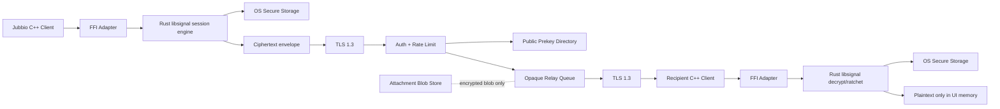

# Jubbio E2EE Güvenlik Mimarisi

**Durum:** Tasarım ve entegrasyon iskeleti  
**Kapsam:** Bire bir mesajlaşma ile başlayan, çoklu cihaz ve grup mesajlaşmasına genişleyebilen Signal Protocol tabanlı uçtan uca şifreleme  
**Varsayım:** Jubbio’nun istemci çekirdeği C++17/Qt veya benzeri bir C++ uygulaması. Mobil istemciler için aynı protokol durum makinesi native katmanlara bağlanacak.

> Bu belge eski 15 katmanlı özel şifreleme yaklaşımının yerine geçer. 15 kez aynı veya farklı algoritmayı üst üste uygulamak Signal seviyesinde güvenlik sağlamaz; protokol doğrulaması, anahtar yaşam döngüsü, ratchet durumu ve cihaz doğrulaması daha önemlidir.

## 1. Güvenlik hedefi

Jubbio sunucusu mesajı taşıyabilmeli fakat mesaj içeriğini okuyamamalı. Bir oturumdaki her mesaj için ayrı anahtar türetilmeli. Bir anahtar sızdığında geçmiş mesajların ve mümkün olduğunca gelecekteki mesajların güvenliği korunmalı. Kullanıcı, karşı tarafın cihaz anahtarını güvenlik kodu veya QR ile doğrulayabilmeli.

“Apple iMessage / Signal seviyesinde” tek bir algoritma seçmekle elde edilmez. Bu hedef; doğru protokol uygulaması, güvenli anahtar depolama, güncelleme süreci, cihaz doğrulama, metadata politikası, testler ve bağımsız denetim gerektirir. Hiçbir sistem çalıntı ve tamamen ele geçirilmiş bir cihazdaki plaintext’i güvenilir biçimde gizleyemez.

## 2. Tehdit modeli

| Aktör | Yapabildiği | Korunmak istediğimiz şey | Sınır |
|---|---|---|---|
| Ağ dinleyen saldırgan | Paketleri kaydetme, geciktirme, yeniden oynatma, trafik analizi | Mesaj içeriği ve medya | IP, zaman, boyut ve alıcı-gönderici ilişkisi tamamen gizlenemez |
| Ele geçirilmiş veya kötü niyetli sunucu | Şifreli paketleri saklama/değiştirme, public key dağıtımını etkileme, hesap enumeration | Plaintext, medya içeriği, ratchet anahtarları | Anahtar doğrulama yapılmazsa aktif MITM riski sürer |
| Kötü niyetli iç kullanıcı | Kendi hesabıyla mesaj alma, içeriği ekran görüntüsü alma, spam/abuse | Başka kullanıcıların mesajları ve hesap güvenliği | Alıcının gördüğü içeriği alıcının kopyalamasını engelleyemeyiz |
| Çalınmış ama kilitli cihaz | Yerel veriye erişim denemesi, offline brute force | Saklanan oturum durumu ve anahtarlar | Güvenli donanım ve güçlü cihaz parolası gerekir |
| Açık/ele geçirilmiş cihaz | Bellek okuma, keylogging, plaintext yakalama, sahte mesaj gönderme | Geçmiş/gelecek mesajlar için sınırlı hasar | Cihaz kontrolü saldırgandaysa E2EE tek başına yeterli değildir |
| Aktif MITM | Public key değiştirme, sahte cihaz ekleme | Kimlik bağlama ve oturum bütünlüğü | QR/güvenlik kodu doğrulaması yapılmazsa risk kalır |
| Sunucu operatörü / log analisti | Metadata ve hata kayıtlarına erişim | İçerik ve mümkün olan minimum metadata | Trafik analizi ve teslimat metadata’sı kısmen kalır |

### Varlıklar

- Kimlik private key’i, signed prekey private key’i, one-time prekey private key’i.
- Double Ratchet root key, sending/receiving chain key’leri ve skipped-message key’leri.
- Mesaj plaintext’i, medya anahtarları ve güvenlik kodu.
- Hesap recovery materyali ve cihaz onay kayıtları.
- Mesajın gönderici/alıcı, zaman, boyut ve teslimat metadata’sı.

## 3. Kriptografi mimarisi

### 3.1. Protokol seçimi

Üretim protokolü **Signal Protocol** ailesinden seçilmelidir:

1. Yeni bire bir oturum için libsignal’ın desteklediği güncel pre-key handshake kullanılır. Uygulama düzeyinde PQXDH/Signal sürümünün desteklediği varyant seçilir; X3DH’yi elle yeniden uygulamayız.
2. Oturum kurulduktan sonra **Double Ratchet** kullanılır. Her mesajın message key’i ayrı türetilir, DH ratchet ile zincir düzenli olarak yenilenir.
3. Mesaj payload’ı için libsignal’ın sürümüne bağlı AEAD kullanılır. Uygulama kendi başına AES-GCM veya ChaCha20-Poly1305 sarmalı eklememelidir.
4. Cihaz kimliği için Curve25519/Ed25519 tabanlı kimlik materyali libsignal’a bırakılır. Dönüşüm ve imza formatlarını kendimiz yazmayız.
5. Signal protokolü dışında kalan yerel şifreli saklama, medya anahtarı sarmalama veya rastgele byte üretimi için **libsodium** kullanılabilir. Aynı veriyi iki farklı protokol katmanında şifreleyerek güvenlik artmış sayılmaz.

Signal’in resmi Double Ratchet dokümanı geçmişteki anahtarların sonradan ele geçirilen zincir anahtarından türetilememesi ve yeni DH girdileri geldikten sonra gelecekteki anahtarların yeniden güven kazanması özelliklerini açıklar: [Signal Double Ratchet specification](https://signal.org/docs/specifications/doubleratchet/). PQXDH asenkron durumda sunucuda duran prekey bundle ile başlangıç kurulmasını ve public key imzalarının doğrulanmasını tanımlar: [Signal PQXDH specification](https://signal.org/docs/specifications/pqxdh/).

### 3.2. C++ için dürüst entegrasyon kararı

Resmi `signalapp/libsignal` deposu protokol uygulamasının Rust’ta olduğunu ve resmi ürün yüzeylerinin Java, Swift ve TypeScript olarak sunulduğunu belirtir; C/C++ ve Node köprülerinin API’leri değişebilir ve dış kullanım desteklenmeyebilir: [libsignal repository](https://github.com/signalapp/libsignal).

Bu nedenle önerilen yığın:

- **C++17/Qt veya mevcut Jubbio C++ istemcisi:** UI, ağ taşıması, mesaj kutusu, bildirim ve uygulama yaşam döngüsü.
- **Rust libsignal bridge:** Signal oturumları, prekey bundle, Double Ratchet, grup protokolü ve sürüm yükseltme.
- **C ABI veya güvenli bir generated FFI:** C++ tarafı yalnızca opaque handle ve byte buffer görür. Rust secret struct’ları C++’a açılmaz.
- **libsodium:** Signal protokolünün yerine değil; güvenli rastgelelik, şifreli yerel dosya/backup sarmalama gibi protokol dışı yardımcı işler için.
- **TLS 1.3:** Sadece istemci-sunucu taşıma ve metadata gizliliğine yardımcı kanal. E2EE’nin yerine geçmez.

C++ projesi, resmi libsignal’ın kararlı C++ API’si yayımlanmadan doğrudan özel kripto kodu yazmamalıdır. Alternatif olarak Android’de resmi Java/Kotlin binding, iOS’ta Swift binding ve desktop’ta TypeScript binding kullanılabilir.

## 4. Anahtar yönetimi

### 4.1. Cihazda oluşturulan anahtarlar

Her cihaz ilk açılışta şunları cihazda üretir:

- Uzun ömürlü identity key pair.
- Signed prekey pair ve imza.
- One-time prekey havuzu.
- Libsignal’ın istediği ek prekey/PQ prekey materyali.

Private key hiçbir zaman sunucuya, analitik sisteme, crash log’una veya normal uygulama log’una gönderilmez. Sunucu yalnızca public identity key, signed prekey, imza ve kullanılabilir one-time prekey public değerlerini tutar.

Depolama:

- iOS: Keychain; mümkünse Secure Enclave destekli key agreement/signing akışı. Secure Enclave’in her kriptografik operasyonu desteklemediği durumlarda key material’i Keychain erişim sınıfı ile koru.
- Android: Android Keystore; hardware-backed key attestation mevcutsa risk politikasına göre kullan.
- Desktop: OS keychain/credential vault. C++ uygulaması secret’i düz dosyaya yazmaz.
- Rooted/jailbroken cihaz tespiti yalnızca sinyal üretir; kesin güvenlik kanıtı olarak kabul edilmez.

### 4.2. Anahtar doğrulama

Kullanıcılar kişi sohbet ekranında:

- Güvenlik kodunun insan tarafından okunabilir kısa gösterimini görür.
- QR ile iki cihazdaki identity public key fingerprint’ini karşılaştırabilir.
- Doğrulanmış anahtar değiştiğinde açık uyarı alır.
- “Yeni cihazı otomatik güven” yerine mevcut doğrulanmış cihazdan onay ister.

Sunucu public key’i değiştirebilir; bu nedenle ilk anahtar alma (TOFU) ile daha sonra QR doğrulaması ayrılmalıdır. İmza doğrulamak, public key’in doğru kişiye ait olduğunu tek başına kanıtlamaz; kullanıcı doğrulaması kimlik bağını güçlendirir.

### 4.3. Çoklu cihaz

Her cihazın ayrı identity key’i ve ayrı libsignal session’ı vardır. Hesap anahtarından deterministik cihaz key’i türetilmez. Yeni cihaz:

1. Cihazda key üretir.
2. Sunucuya public prekey bundle yükler.
3. Mevcut doğrulanmış cihazdan kullanıcı onayı alır.
4. Cihaz listesine eklenir.
5. Mesaj gönderirken her onaylı cihaz için ayrı E2EE envelope oluşturulur veya libsignal’ın desteklediği grup/çoklu cihaz mekanizması kullanılır.

Cihaz kaldırılınca yeni mesaj dağıtımı durur ve kalan cihazlar yeni session başlatır. Eski cihazdaki private key’in silinmesi işletim sistemi ve yedekleme davranışına bağlı olduğu için kullanıcıya açık bilgi verilir.

## 5. Gizlilik ve saldırı dayanıklılığı

- **Forward secrecy:** Her mesajın key’i ratchet zincirinden türetilir ve kullanımdan sonra silinir.
- **Post-compromise security:** DH ratchet yeni katkı aldığında iletişim zamanla toparlanır; ancak aktif ve sürekli ele geçirilmiş cihaz için garanti yoktur.
- **Replay koruması:** Session state message number, previous chain length ve skipped-message key sınırları ile doğrulanır. Sunucu idempotency token saklayarak aynı envelope’un tekrar teslim edilmesini sınırlayabilir.
- **Mesaj imzalama:** Her mesajı uygulama seviyesinde Ed25519 ile ayrıca imzalamak Signal’ın deniability tasarımını ve metadata’yı gereksiz yere bozabilir. Kimlik doğrulama ve AEAD doğrulaması için libsignal kullanılır; hukuki inkâr edilemez imza ancak ayrı, bilinçli bir ürün gereksinimiyse eklenir.
- **Kaybolan mesajlar:** Süre dolunca UI plaintext’ini, medya açık kopyasını, session’dan ayrılmış message key’i ve thumbnail/cache’i siler. OS yedekleri, notification geçmişi, klavye öğrenme verisi ve ekran görüntüsü ayrı risklerdir.
- **Metadata minimizasyonu:** Sunucu mesaj içeriğini, arama indeksini ve plaintext push payload’ını görmez. Kullanıcı adı keşfi için körlenmiş/hashed identifier, sealed sender benzeri tasarım ve kısa saklama süreleri değerlendirilir. Trafik zamanı/boyutu tamamen yok olmaz.
- **Bildirimler:** Push payload yalnızca “yeni mesaj var” gibi içeriksiz bilgi taşımalı; plaintext notification kullanılmamalı.

## 6. Sunucu tasarımı

Sunucu bileşenleri:

1. **Account/Auth service:** passkey/WebAuthn, 2FA, cihaz onayı ve rate limit.
2. **Key directory:** Public identity/prekey bundle saklar; private key kabul etmez. One-time prekey tüketimi atomik olmalıdır.
3. **Relay/queue:** Opaque ciphertext envelope saklar ve doğru cihazlara teslim eder. İçerik parse edilmez.
4. **Attachment service:** İstemcinin rastgele medya anahtarıyla şifrelediği blob’u saklar; blob anahtarı E2EE mesaj içinde gider.
5. **Abuse service:** İçeriği okuyamadan hesap davranışı, rate limit, raporlanan plaintext ve kullanıcı onayı üzerinden çalışır.
6. **Audit/metrics:** İçerik, key, token ve decrypted payload loglanmaz.

Taşıma ve servis kontrolleri:

- TLS 1.3; güvenli cipher suite ve sertifika yenileme.
- Mobilde certificate pinning yalnızca kontrollü rotasyon ve recovery planı ile; aksi halde yanlış pin uygulamanın güncellenememesine neden olabilir.
- Kullanıcı/telefon/e-posta enumeration’a karşı sabit davranışlı cevaplar, uniform hata mesajları ve hız sınırlama.
- IP, kullanıcı adı ve cihaz sorgularında abuse/rate limit.
- Güvenli log redaction; ciphertext, security code, Authorization header, session key ve plaintext loglanmaz.
- Operatörler için üretim erişimi, kısa ömürlü yetki, iki kişili onay ve değiştirilemez audit log.
- Sunucu yedeği ciphertext olsa bile retention ve silme talepleri politikasına göre yönetilir.

### Örnek sunucu veri modeli

```text
DevicePublicBundle {
  account_id: opaque_id
  device_id: random_id
  identity_key_public: bytes
  signed_prekey_public: bytes
  signed_prekey_signature: bytes
  one_time_prekeys: [{id, public_key}]
  pq_prekeys: [{id, public_key, signature}] // libsignal sürümüne göre
  created_at: timestamp
  expires_at: timestamp
}

RelayEnvelope {
  envelope_id: random_id
  recipient_device_id: random_id
  ciphertext: bytes       // sunucu tarafından çözülemez
  expires_at: timestamp
  delivered_at: timestamp?
}
```

## 7. Kimlik doğrulama ve oturum

- Birincil giriş: WebAuthn/passkey.
- Kurtarma: yüksek entropili kullanıcı PIN’i veya recovery key; sunucu plaintext PIN tutmaz. KDF ve rate limit zorunludur.
- Yeni cihaz: mevcut cihaz onayı + passkey; tek başına SMS yeterli değildir.
- Oturum token’ı kısa ömürlü access token ve döndürülen refresh token olarak tutulur. Refresh token cihaz secure storage’da saklanır ve server-side revoke edilebilir.
- Hassas işlemler: yeni cihaz ekleme, güvenlik ayarı değiştirme ve yedek geri yükleme için step-up authentication.
- Hesap kurtarma ile E2EE anahtar kurtarma birbirinden ayrılır; sunucu hesabı geri verebilir ama geçmiş plaintext’i otomatik açmamalıdır.

## 8. Uygulama güvenliği

- Mesaj ve medya cache’i şifreli ve süreli olmalı; plaintext crash dump’a girmemeli.
- Clipboard paylaşımı açık kullanıcı eylemiyle ve kısa süreli olmalı; hassas mesaj kopyalanırken uyarı gösterilebilir.
- Android screenshot/screen recording kısıtlaması ve iOS ekran yakalama tespiti yalnızca caydırıcı kontroldür; karşı cihazla fotoğraf alınmasını önleyemez.
- Root/jailbreak tespitini bloklayıcı tek karar haline getirme; risk skoru ve kullanıcı açıklaması kullan.
- Bağımlılık lockfile, SBOM, imzalı release, reproducible build ve CI dependency scanning.
- Fuzz edilecek yüzeyler: envelope parser, prekey bundle parser, FFI sınırları, attachment manifest, push payload parser.
- C++/Rust FFI’de sahiplik kuralları net olmalı; Rust’ın opaque handle’ı yalnızca kendi destructor’ı ile bırakılmalı.

## 9. Mimari diyagram



### Mesaj akışı

```text
Alice device -> fetch Bob device prekey bundle
Alice device -> verify signed prekeys / identity policy
Alice libsignal -> establish session and encrypt initial message
Alice client -> POST opaque envelope over TLS 1.3
Relay server -> store/forward; never decrypt
Bob client -> fetch envelope
Bob libsignal -> authenticate, ratchet, decrypt
Bob UI -> render plaintext; no server-side search/index
```

## 10. C++ entegrasyon iskeleti

Aşağıdaki iskelet kasıtlı olarak kriptografik algoritma uygulamaz. `SignalSessionBackend` gerçek libsignal bridge ile doldurulmalıdır. Bu sınıfa AES, X25519 veya Double Ratchet elle eklenmemelidir.

```cpp
// e2ee_service.hpp
#pragma once
#include <cstdint>
#include <span>
#include <string>
#include <vector>

struct DeviceId { std::string value; };
struct PublicPreKeyBundle { std::vector<std::uint8_t> encoded; };
struct SessionHandle { void* opaque = nullptr; };

class SignalSessionBackend {
public:
    virtual ~SignalSessionBackend() = default;
    virtual SessionHandle load_or_create_session(
        const DeviceId& peer, const PublicPreKeyBundle& bundle) = 0;
    virtual std::vector<std::uint8_t> encrypt(
        SessionHandle session, std::span<const std::uint8_t> plaintext,
        std::span<const std::uint8_t> associated_data) = 0;
    virtual std::vector<std::uint8_t> decrypt(
        SessionHandle session, std::span<const std::uint8_t> ciphertext,
        std::span<const std::uint8_t> associated_data) = 0;
    virtual void destroy(SessionHandle session) = 0;
};

class E2eeService {
public:
    explicit E2eeService(SignalSessionBackend& backend) : backend_(backend) {}
    std::vector<std::uint8_t> encrypt_for_device(
        const DeviceId& peer, const PublicPreKeyBundle& bundle,
        std::span<const std::uint8_t> plaintext,
        std::span<const std::uint8_t> aad = {}) {
        auto s = backend_.load_or_create_session(peer, bundle);
        auto out = backend_.encrypt(s, plaintext, aad);
        backend_.destroy(s);
        return out;
    }
private:
    SignalSessionBackend& backend_;
};
```

FFI sınırı için öneri:

```text
C++ -> e2ee_session_create(peer_id, prekey_bundle_bytes)
C++ -> e2ee_session_encrypt(handle, plaintext, aad, out_buffer)
C++ -> e2ee_session_decrypt(handle, ciphertext, aad, out_buffer)
C++ -> e2ee_session_destroy(handle)
Rust -> libsignal + secure state serialization
```

Gerçek bridge’in sürüm pin’leri, Rust crate API’si ve lisans/dağıtım koşulları ayrıca incelenmelidir. Resmi libsignal deposu dış kullanımın desteklenmediğini ve API’lerin değişebileceğini belirtir; bu nedenle sürüm yükseltmeleri bağımsız güvenlik ve regression testinden geçmeden yapılmamalıdır.

## 11. Test ve denetim planı

### MVP testleri

- Her platformda session kurulumu ve ilk mesaj.
- Mesaj sırası bozulması, gecikme, duplicate ve kayıp paket.
- Yanlış public key, değiştirilmiş ciphertext, bozuk header ve bozuk prekey bundle.
- Signed prekey ve one-time prekey atomik tüketimi.
- Cihaz ekleme/kaldırma ve key-change uyarısı.
- Uygulama kapanması, process crash’i, offline/online geçişi.
- Secret’in log, telemetry, clipboard ve notification’a sızmadığı testleri.

### Fuzz ve property testleri

- FFI buffer length/ownership fuzzing.
- Envelope ve attachment manifest parser fuzzing.
- “decrypt(encrypt(m)) == m” round-trip.
- Tek bit değişikliğinde decrypt başarısız olmalı.
- Aynı mesaj iki kere teslim edilse bile state bozulmamalı.
- Skipped message key limiti ve bellek üst sınırı.

### Sızma testi

1. Ağ MITM ve TLS downgrade denemesi.
2. Kötü niyetli relay ile ciphertext değiştirme, replay ve key substitution.
3. Account enumeration ve prekey exhaustion.
4. Çalıntı cihaz image/file system incelemesi.
5. Root/jailbreak ve debugger davranışı.
6. Push, analytics, crash reporting ve attachment erişim kontrolü.
7. Çoklu cihazdan çıkarılan cihazın mesaj alamadığının doğrulanması.

### Bağımsız denetim ve bug bounty

- Protokol tasarımı ve threat model review.
- Rust/FFI memory-safety incelemesi.
- Mobil secure storage ve backup review.
- Sunucu erişim, loglama ve deployment review.
- Üretimden önce bağımsız kriptografi denetimi.
- Responsible disclosure politikası, güvenlik iletişim adresi ve kapsamlı bug bounty. Ödül tutarı ancak bütçe ve risk sınıfları belirlendikten sonra ilan edilmelidir.

## 12. Öncelikli yol haritası

### Faz 0 — Tasarım kilidi

- Jubbio istemci ve sunucu repository sınırlarını belirle.
- Platformları ve hedef libsignal binding’ini kesinleştir.
- Key lifecycle, cihaz modeli ve metadata retention kararlarını yazılı onaya bağla.
- Eski 15 katmanlı kodu üretim yolundan çıkar; veri formatını yeni envelope’a geçirecek migration planı hazırla.

### Faz 1 — MVP bire bir E2EE

- Bir cihazdan bir cihaza libsignal session.
- Public prekey directory ve atomic one-time prekey tüketimi.
- Opaque relay ve TLS 1.3.
- OS secure storage.
- Güvenlik kodu/QR doğrulaması.
- Basic key-change warning.
- No plaintext server search, logs or push payload.
- Unit, integration ve fuzz test altyapısı.

### Faz 2 — Üretim sertleştirme

- Passkey/2FA, cihaz onayı, revoke.
- Çoklu cihaz ve cihaz listesi.
- Şifreli medya ve expiry.
- Kaybolan mesajlar ve cache/backup temizliği.
- Rate limit, abuse controls, safe logs, SBOM, signed releases.
- Bağımsız güvenlik denetimi.

### Faz 3 — İleri seviye gizlilik

- Sealed-sender benzeri teslimat metadata minimizasyonu.
- Kullanıcı adı keşfi için privacy-preserving lookup.
- Grup mesajlaşması için libsignal’ın desteklediği grup protokolü veya değerlendirilmiş MLS tasarımı; bire bir Double Ratchet’ı gruplara kopyalama.
- PQXDH/hibrit post-quantum desteğinin libsignal sürümüyle uyumlu şekilde açılması.
- Güvenli yedekleme ve kullanıcı kontrollü recovery.
- Bug bounty ve düzenli üçüncü taraf denetimleri.

## 13. Bilinen zayıflıklar ve açık kararlar

- Sunucu mesaj içeriğini göremez ama teslimat metadata’sını görebilir; metadata’yı tamamen gizlemek ayrı bir projedir.
- Kimlik doğrulaması yapılmayan ilk public key dağıtımı MITM’e açıktır; QR/security code UX zorunludur.
- Ele geçirilmiş cihaz plaintext’i, ekranı ve girişleri okuyabilir.
- Certificate pinning yanlış yönetilirse istemci güncellemelerini ve recovery’yi bozabilir.
- Güvenli backup, kullanıcı kurtarılabilirliği ile E2EE arasında ürün kararıdır; sunucuya master key yüklenmemelidir.
- Grup, arama, spam ve moderasyon özellikleri E2EE nedeniyle yeniden tasarlanır; sunucu tarafında plaintext indeksleme yapılamaz.
- Resmi libsignal API’leri ve köprüleri sürümden sürüme değişebilir; C++ özel bridge bakım maliyeti vardır.
- libsodium bu mimaride Signal Protocol’un yerine geçmez; yalnızca protokol dışı güvenli yardımcılar için kullanılır.

## 14. Kaynaklar

- [Signal Documentation](https://signal.org/docs/)
- [The Double Ratchet Algorithm](https://signal.org/docs/specifications/doubleratchet/)
- [The PQXDH Key Agreement Protocol](https://signal.org/docs/specifications/pqxdh/)
- [Official libsignal repository](https://github.com/signalapp/libsignal)
- [libsodium documentation](https://doc.libsodium.org/)

## Sonuç

Jubbio için önerilen güvenli temel, eski 15 katmanlı özel şifreleme değil; cihazda üretilen anahtarlar, doğrulanmış prekey bundle, resmi libsignal oturumları, Double Ratchet, güvenli OS storage ve yalnızca şifreli veri taşıyan bir relay sunucusudur. C++ uygulaması bu sistemi kendi kriptografisini yazarak değil, sürümlenmiş Rust/libsignal bridge üzerinden kullanmalıdır. Bu dosya üretim entegrasyon planı ve kod iskeletidir; gerçek Jubbio kaynak kodu, API’si ve seçilecek platformlar görülmeden çalışan üretim modu olduğu iddia edilemez.


## Eklenen savunma katmanları

Mevcut relay servisine E2EE protokolünün dışındaki savunma katmanları da eklenmiştir: timestamp + tek kullanımlık nonce replay cache’i, IP/cihaz/peer bazlı zamanla azalan risk puanı, eşiklerle kademeli tepki ve içerik taşımayan hash-zincirli olay günlüğü. Olay kaydı mesaj veya anahtar saklamaz; retention ve KVKK/GDPR politikası deployment tarafından belirlenmelidir.

Yerel secret saklama için scrypt + AES-256-GCM parola kasası eklenmiştir. Bu kasa Signal identity/prekey anahtarlarının yerine geçmez; gerçek identity/prekey private key’leri libsignal ve işletim sistemi secure storage içinde kalmalıdır. JavaScript buffer temizliği best-effort olduğundan kesin RAM silme garantisi değildir.

Decoy servis ayrı Docker imajı ve ayrı ağ profili olarak bulunur. Gerçek relay ağına bağlanmaz, yalnızca erişim olayının hashlenmiş IP’sini ve endpoint metadata’sını içeriksiz audit kaydına yazar. Yüksek risk yönlendirmesi reverse proxy/WAF seviyesinde ve ayrı makine/segment üzerinde yapılmalıdır; uygulama içinden şüpheli isteği gerçek veriye sahip decoy’a otomatik forward etmek güvenli değildir.
